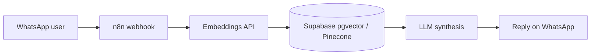

<h1 align="center">Matías Di Benedetto Morales</h1>

  <b>AI & Automation Developer</b> · RAG agents · n8n workflows · applied ML 
  México · Open to AI Engineer, Automation Developer and ML Engineer roles

  <a href="https://aidib-portfolio.vercel.app/">Portfolio</a> ·
  <a href="https://aidib-portfolio.vercel.app/paper/">ML paper</a> ·
  <a href="mailto:matiasdibe23@gmail.com">Email</a>

---

## What I build

- **WhatsApp AI agents with retrieval-augmented generation** (n8n, Supabase/pgvector, Pinecone, LLM synthesis).
- **Automation workflows** that replace manual back-office work.
- **Decision-support ML** with leakage-safe validation, honest baselines and explicit human-in-the-loop rules.

## Featured work

### 1. Content Decay Forecasting: which pages lose clicks next?
Applied ML on six months of real, pseudonymized Search Console data (FlyRank ML internship). Features from days 1-15 of a month, label from days 16-end, tested forward in time.

- **Random Forest ROC-AUC 0.704 vs 0.633** for a one-line click-momentum rule on 19 seen clients (+0.071, 95% client-bootstrap interval +0.015 to +0.092).
- **On 6 unseen clients the two could not be separated.** Reported as inconclusive, not hidden.
- **A previous score ranked below chance (0.431).** Documented, not buried.
- **My own first model scored 1.0000 because the label was a SQL rule over its features.** I audited it, wrote the audit up and rebuilt the pipeline with leak controls: shuffled-label 0.506, deliberate-leak control 0.704 → 0.946.
- **Playbook:** 3 validated reason codes, 2 dropped because they failed validation, and a 3-tier review queue (top tier decayed at 0.39-0.43 vs 0.24-0.27 base rate).

**Stack:** Python · DuckDB · pandas · scikit-learn  
**Repo:** [Flyrank-Starter-Notebooks](https://github.com/matiasdibe23-sys/Flyrank-Starter-Notebooks) · **Paper:** [aidib-portfolio.vercel.app/paper](https://aidib-portfolio.vercel.app/paper/)

### 2. Agente Experto 360: WhatsApp RAG assistant
A WhatsApp agent that answers customer questions from a client's own knowledge base, retrieving sources at query time instead of generating from memory.

**Stack:** n8n · Supabase · Pinecone · Python · WhatsApp API  
**Case study:** [aidib-portfolio.vercel.app](https://aidib-portfolio.vercel.app/)

<!-- TODO before publishing: add 2-4 measured numbers here (retrieval accuracy on an eval set, p95 latency, cost per conversation) or leave this block as is. Do not publish placeholders. -->

### 3. Production portfolio site, hardened
Static site with a serverless contact endpoint (Vercel Functions + Resend), then attacked on purpose: 33 browser and API tests covering malformed payloads, double-submit, XSS, honeypot bots and timeouts.

- PageSpeed: **Desktop 100 / 96 / 100 / 100**, **Mobile 92 / 96 / 100 / 100** (Performance / Accessibility / Best Practices / SEO)
- Known limits documented: Resend free tier (100 emails/day), no per-IP rate limiting

**Stack:** HTML · CSS · Vanilla JS · Node.js · Vercel · Resend  
**Repo:** [aidib-portfolio](https://github.com/matiasdibe23-sys/aidib-portfolio)

## Stack

## How I work

- **Evidence before claims.** Every number in my ML work traces to a committed file.
- **Baselines and leak controls before model tuning.** I report where the model does not beat a simple rule.
- **Humans stay in the loop** for high-impact decisions, and the system lists what it must never touch.
- **Security by default.** Server-side secrets, validation on both sides, documented limits.

## Background

B.Eng. in Information Technologies and Digital Business, Universidad Anáhuac Querétaro · Freelance AI developer · IITOOLS · ML internship at [FlyRank](https://flyrank.ai)
